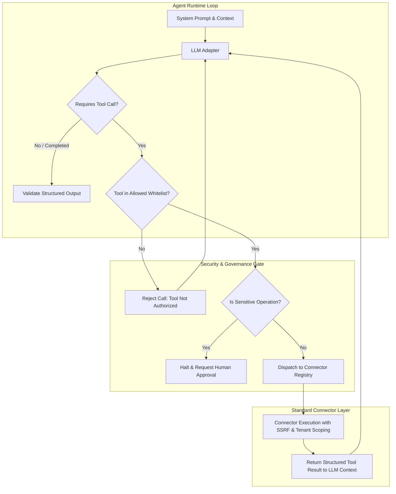

# AI Agent Runtime & Controlled Tool Execution

## 1. Principles of Governed Agent Execution

In NEXORA Operations, AI models and autonomous agents are **first-class workflow participants**, but they do **not** run unconstrained.

In enterprise automation, unconstrained agent loops risk:
- Infinite loops and runaway token costs.
- Hallucinated or unauthorized external API calls.
- Security boundary violations (cross-tenant data leakage).
- Irreversible side effects (sending unapproved emails or modifying financial records).

To eliminate these failure modes, the NEXORA Agent Runtime enforces **Bounded Autonomous Loops** with strict policy gates.

---

## 2. Agent Execution Budget & Guardrails

Every agent execution node defines explicit boundaries:

```typescript
export interface AgentExecutionPolicy {
  maxIterations: number;      // Strict loop cap (default: 5, maximum allowed: 10)
  maxToolCalls: number;        // Maximum cumulative tool invocations (default: 5)
  timeoutMs: number;           // Wall-clock execution timeout (default: 30,000 ms)
  maxTokens: number;           // Max token budget per node execution (default: 4,000)
  allowedTools: string[];      // Whitelist of permitted tool identifiers (e.g. ["crm:findContact", "crm:createLead"])
  requireHumanConfirmation: string[]; // High-risk operations requiring approval before dispatch
}
```

If an agent exceeds its iteration limit or timeout, the execution fails cleanly with a `BudgetExceededError`, and the workflow engine takes the designated failure branch or alerts an operator.

---

## 3. Tool Sandbox & Connector Bridge

Agents cannot execute arbitrary code or query the database directly. Tools exposed to an agent are strictly derived from the platform's **Connector Registry**:



### Function Schema Generation
The runtime automatically converts Zod input schemas from registered `ConnectorOperation` definitions into OpenAI / Gemini compatible tool declarations (`parameters: zodToJsonSchema(operation.inputSchema)`).

---

## 4. Multi-Provider LLM Abstraction

The agent runtime interacts with language models through a typed `LlmProvider` interface:

```typescript
export interface ChatMessage {
  role: 'system' | 'user' | 'assistant' | 'tool';
  content?: string;
  toolCalls?: ToolCall[];
  toolCallId?: string;
}

export interface LlmProvider {
  id: string;
  name: string;
  generateCompletion(request: CompletionRequest): Promise<CompletionResponse>;
}
```

### 4.1. Deterministic Mock LLM Provider (Offline & Local CI)
To ensure the platform runs completely without external API keys or cloud dependencies, NEXORA includes a `DeterministicMockLlmProvider`:
- Evaluates input content against deterministic pattern rules (e.g. classifying "Urgent billing question" $\rightarrow$ `BILLING` with high priority).
- Emits realistic tool calls (e.g. calling `crm:findContact` with the extracted email).
- Emits strictly typed JSON for structured extraction nodes.
- Simulates realistic token counts and response latency (configurable).

### 4.2. OpenAI / Gemini Compatible Provider
Connects to standard OpenAI-compatible endpoints (`/chat/completions`) or Gemini REST endpoints when configured in environment variables (`OPENAI_API_KEY`, `GEMINI_API_KEY`).

---

## 5. Core AI Workflow Use Cases

1. **Lead Qualification & Intent Classification**:
   - Takes unstructured inquiry text $\rightarrow$ outputs categorical classification (`ENTERPRISE_LEAD`, `PARTNER`, `SPAM`) + confidence score + reasoning.
2. **Customer Support Triage**:
   - Parses support ticket subject and body $\rightarrow$ extracts department (`TECH_SUPPORT`, `BILLING`, `LEGAL`), urgency (`LOW`, `MEDIUM`, `CRITICAL`), and sentiment.
3. **Structured Document / Invoice Extraction**:
   - Ingests raw text/JSON $\rightarrow$ extracts vendor name, line items, invoice number, tax amounts, and payment terms validated against a Zod schema.
4. **Autonomous Triage Agent with Tools**:
   - Ingests incoming lead $\rightarrow$ queries CRM for existing customer history $\rightarrow$ calculates lead score $\rightarrow$ decides whether to schedule a demo or send standard brochure.
