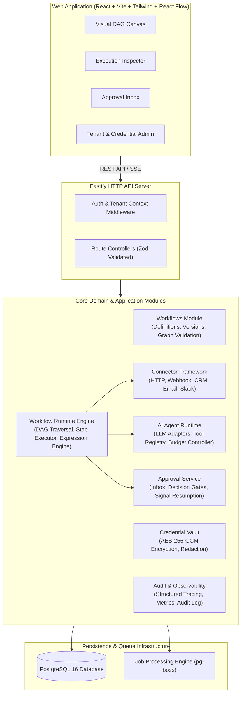

# NEXORA Operations — AI Automation Platform Architecture

## 1. System Overview

**NEXORA Operations** is an enterprise-grade workflow orchestration and automation platform designed to reliably automate multi-step business processes across sales, customer service, operations, and administrative functions.

The platform provides:
- **Directed Acyclic Graph (DAG) Workflow Engine**: Deterministic topological execution with conditional branching, node-level retry policies, and structured data flow.
- **Durable Asynchronous Processing**: State-persisted executions resilient to worker crashes, with step-level replay and resumption capabilities.
- **Enterprise Integrations**: Pluggable connectors for REST APIs, Webhooks, CRM, Email, and Messaging with comprehensive SSRF protection and credential vaulting.
- **Controlled AI Agents**: Bounded agent execution loops with explicit function-calling tool registries, budget limits (iterations, tool calls, tokens), and deterministic mock fallbacks.
- **Human-in-the-Loop (HITL) Approvals**: First-class pause-and-resume approval gates tied to workflow state and role-based approvers.
- **Multi-Tenancy & Governance**: Organization-level isolation, granular RBAC (Admin, Editor, Operator, Approver, Viewer), audit trails, and execution telemetry.

---

## 2. Architectural Style: Modular Monolith

The platform is designed as a **Modular Monolith**. Rather than introducing distributed microservices overhead (network latency, distributed transactions, complex RPC schemas), the architecture maintains strict internal module boundaries enforced by TypeScript interfaces and domain packages.



---

## 3. Monorepo Structure

```
AI-Automation-Platform-Public/
├── apps/
│   ├── api/                     # Fastify REST API & Background Job Worker
│   │   ├── src/
│   │   │   ├── server.ts        # Fastify server bootstrap & plugins
│   │   │   ├── routes/          # REST endpoints (auth, workflows, executions, etc.)
│   │   │   ├── workers/         # Background queue workers (pg-boss)
│   │   │   └── config/          # Environment configuration & Zod env validation
│   └── web/                     # React Single-Page Application
│       ├── src/
│       │   ├── components/      # UI components (shadcn/ui + Tailwind)
│       │   ├── pages/           # Views: Workflows, Canvas, Executions, Approvals, Settings
│       │   ├── canvas/          # React Flow custom nodes, edges, and controls
│       │   └── api/             # Typed API client
├── packages/
│   ├── domain/                  # Core domain models, entities, and validation schemas
│   ├── workflow-engine/         # DAG graph builder, Kahn cycle detection, step execution
│   ├── connectors/              # Connector SDK, SSRF safe HTTP, CRM, Email, Slack
│   ├── agent-runtime/           # LLM adapters (deterministic mock & OpenAI), tool sandbox
│   └── shared/                  # Common utilities, error classes, logger, encryption
├── database/
│   ├── schema.prisma            # Prisma schema (PostgreSQL)
│   ├── migrations/              # Database migration SQL files
│   └── seeds/                   # Seed data (demo organizations, users, workflows)
├── examples/
│   ├── workflows/               # Demo workflow definitions (JSON)
│   └── payloads/                # Sample webhook payloads for manual verification
├── tests/
│   ├── unit/                    # Fast isolated unit tests (Vitest)
│   ├── integration/             # Database, API, and worker integration tests
│   ├── security/                # SSRF, RBAC, tenant isolation, encryption tests
│   └── e2e/                     # End-to-end multi-step workflow execution tests
├── docs/                        # Architectural documentation, specifications, and ADRs
└── docker-compose.yml           # Local PostgreSQL & platform orchestration
```

---

## 4. Module Boundaries & Responsibilities

| Module | Core Responsibilities | Dependencies |
| :--- | :--- | :--- |
| `identity` | User authentication, password hashing (Argon2id/bcrypt), JWT session issuance. | `shared` |
| `organizations` | Tenant scoping, organization membership, role assignment. | `identity`, `shared` |
| `workflows` | Workflow metadata CRUD, version pinning, visual layout persistence. | `organizations`, `shared` |
| `workflow-runtime` | Graph parsing, topological sorting, DAG traversal, step dispatch, expression evaluation. | `workflows`, `connectors`, `agent-runtime`, `approvals`, `executions` |
| `executions` | Execution lifecycle tracking, step state persistence, error capture, cancellation. | `workflows`, `shared` |
| `triggers` | Webhook ingestion (HMAC verification, deduplication), scheduled crons, manual execution. | `workflow-runtime`, `executions` |
| `connectors` | Connector interface, SSRF protection, HTTP client, mock CRM, mock Email. | `credentials`, `shared` |
| `credentials` | AES-256-GCM encryption/decryption at rest, credential metadata, zero plaintext exposure. | `organizations`, `shared` |
| `agents` | AI agent step execution, LLM abstraction, tool calling sandbox, iteration limits. | `connectors`, `shared` |
| `approvals` | Approval ticket creation, approver authorization, decision recording, workflow resumption. | `executions`, `workflow-runtime`, `shared` |
| `observability` | Structured logging (Pino), correlation IDs, execution metrics, sanitization. | `shared` |
| `audit` | Append-only immutable log for governance, security events, and approval actions. | `organizations`, `shared` |

---

## 5. End-to-End Execution Sequence

```mermaid
sequenceDiagram
    autonumber
    actor Client as External Webhook / Operator
    participant Gateway as API Gateway (Fastify)
    participant TriggerSvc as Trigger Service
    participant Queue as Job Queue (pg-boss)
    participant Worker as Workflow Runtime Worker
    participant DB as PostgreSQL Database
    participant Connector as External Connector / LLM
    actor Approver as Human Approver

    Client->>Gateway: POST /api/v1/triggers/webhook/:id
    Gateway->>TriggerSvc: Verify signature & validate payload
    TriggerSvc->>DB: Insert Execution (status: PENDING)
    TriggerSvc->>Queue: Enqueue execution job (executionId, workflowVersion)
    Gateway-->>Client: 202 Accepted (executionId returned)

    Queue->>Worker: Dispatch execution job
    Worker->>DB: Update Execution (status: RUNNING)
    loop Each Topological Node in DAG
        Worker->>DB: Insert Step Execution (status: RUNNING)
        alt Automated Node (HTTP, AI, CRM, Transform)
            Worker->>Connector: Execute operation with input context
            Connector-->>Worker: Return structured output
            Worker->>DB: Update Step Execution (status: COMPLETED, output)
        else Human Approval Node
            Worker->>DB: Insert Approval Request (status: PENDING)
            Worker->>DB: Update Execution (status: WAITING)
            Worker-->>Queue: Complete job step; pause execution
            Approver->>Gateway: POST /api/v1/approvals/:id/decide (APPROVED)
            Gateway->>DB: Update Approval (status: APPROVED)
            Gateway->>Queue: Enqueue resume job (executionId, stepId)
            Queue->>Worker: Dispatch resume job
            Worker->>DB: Update Execution (status: RUNNING)
            Worker->>DB: Update Step Execution (status: COMPLETED)
        end
    end
    Worker->>DB: Update Execution (status: COMPLETED, duration)
```

---

## 6. Technology Stack Decision Rationale

- **Runtime & Language**: Node.js LTS with TypeScript in strict mode for compile-time safety and JSON-native data transformation.
- **Web Framework**: Fastify for low overhead, native schema validation using JSON-schema/Zod, and robust lifecycle hooks.
- **Persistence**: PostgreSQL 16 with Prisma ORM for type-safe queries, relational consistency, and atomic transaction guarantees.
- **Queue System**: `pg-boss` (PostgreSQL-backed queue) avoids adding Redis or RabbitMQ infrastructure while guaranteeing transactional enqueueing within PostgreSQL transactions.
- **Frontend**: Vite + React 18 + Tailwind CSS + React Flow for an interactive DAG canvas.
- **Validation**: Zod across both API contracts and runtime workflow schemas.
- **Testing**: Vitest for fast unit, integration, and security test coverage.
