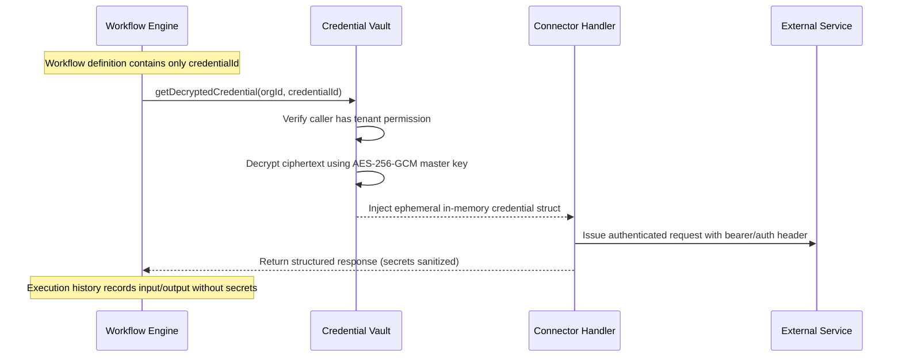

# Enterprise Connector Framework & Integrations

## 1. Overview & Unified Connector Contract

The NEXORA Automation Platform employs a pluggable, contract-driven Connector Framework. Every external SaaS or protocol integration implements the standard `ConnectorContract`:

```typescript
export interface ConnectorOperation<TConfig = unknown, TInput = unknown, TOutput = unknown> {
  id: string;
  name: string;
  description: string;
  inputSchema: ZodSchema<TInput>;
  outputSchema: ZodSchema<TOutput>;
  isIdempotent: boolean;
  rateLimit?: {
    maxRequests: number;
    windowSeconds: number;
  };
  execute(context: ExecutionContext, config: TConfig, input: TInput): Promise<TOutput>;
}

export interface ConnectorContract {
  id: string;
  name: string;
  category: 'api' | 'messaging' | 'crm' | 'ai' | 'storage';
  description: string;
  configSchema: ZodSchema<unknown>;
  credentialType?: 'bearer_token' | 'api_key' | 'oauth2' | 'basic_auth' | 'none';
  operations: Map<string, ConnectorOperation>;
}
```

---

## 2. Implemented Connectors

### 2.1. Generic HTTP / REST Connector
Enables arbitrary REST integration while enforcing defense-in-depth against Server-Side Request Forgery (SSRF).

- **Methods**: `GET`, `POST`, `PUT`, `PATCH`, `DELETE`.
- **Headers & Query Parameters**: Templated dynamic resolution with header sanitization.
- **Body**: JSON, URL-encoded, or raw text.
- **SSRF Defense Policy**:
  - Validates IP resolution before socket connection.
  - Prohibits IPv4 private subnets: `10.0.0.0/8`, `172.16.0.0/12`, `192.168.0.0/16`.
  - Prohibits loopback: `127.0.0.0/8`, `::1`.
  - Prohibits link-local / Cloud metadata: `169.254.169.254`, `fd00::/8`.
  - Re-evaluates target IP on HTTP 301/302 redirects (preventing redirect-based SSRF bypass).
  - Enforces request timeout (default 10s, max 30s).

### 2.2. Outbound Webhook Connector
Sends guaranteed outbound notifications to customer endpoints or external event hubs.

- **Payload Formatting**: JSON payload populated via node expressions.
- **Security & Integrity**: Computes `X-Nexora-Signature: sha256=<hex_hmac>` using tenant-configured signing secrets.
- **Timestamp & Replay Header**: Includes `X-Nexora-Timestamp: <unix_epoch>`.
- **Retry Policy**: 3 exponential retries for network timeouts and 5xx errors; 4xx errors treated as permanent client errors.

### 2.3. Email Connector (Deterministic Mock & Resend Provider)
Delivers transactional notifications and approval requests.

- **Deterministic Offline Mock**:
  - Captures sent emails in an in-memory/database `EmailOutbox` table.
  - Returns predictable message IDs (`mock_msg_<uuid>`) and records recipient, subject, and rendered HTML for test assertion and inspection in the UI.
- **Live Provider Adapter**:
  - Implements Resend REST API adapter with API key authentication for production environments.
- **Template System**:
  - Supports variable substitution in subjects and HTML body templates.

### 2.4. CRM Connector (Fictional NEXORA CRM)
Simulates an enterprise CRM (e.g. Salesforce or HubSpot) using local PostgreSQL tables, ensuring full demo workflows execute offline without paid accounts.

- **Operations**:
  - `findContact(email: string)`: Searches contacts by normalized email.
  - `createContact(contact: ContactInput)`: Creates a new contact record.
  - `createLead(lead: LeadInput)`: Creates a lead with qualification status, score, and assigned sales rep.
  - `updateLead(leadId: string, patch: LeadPatchInput)`: Updates status (e.g. `QUALIFIED`, `REJECTED`, `CONTACTED`).
  - `addNote(entityType: string, entityId: string, content: string)`: Appends an audit note.
- **Persistence**: Persists directly into tenant-scoped `crm_contacts`, `crm_leads`, and `crm_activities` tables.

### 2.5. Slack-Compatible Messaging Connector
Sends alerts to internal team channels and incident rooms.

- **Operations**:
  - `postMessage(channel: string, text: string, blocks?: unknown[])`: Posts formatted Markdown messages to a Slack webhook or compatible endpoint.
- **Offline Mock**:
  - Records outbound messages in the platform's audit trail and local event feed.

---

## 3. Credential Injection & Zero-Trust Secret Isolation



- **Workflow definitions never store plaintext tokens or passwords.** They store foreign keys to `credentials.id`.
- **API responses redact secrets:** The API returns `{ id, name, type, createdAt, lastUsedAt }`, never the secret value.
- **Execution outputs scrub authorization headers:** Sensitive headers (`Authorization`, `X-Api-Key`, `Cookie`) are strictly filtered from execution logs.
