# NEXORA Operations — Implementation Plan & Phase Roadmap

This document defines the phase-by-phase implementation roadmap for the **AI-Automation-Platform** portfolio showcase. Each phase contains explicit deliverables, verification criteria, and quality gates.

---

## Roadmap Overview

```mermaid
flowchart LR
    P1[Phase 1:<br/>Architecture & Specs] --> P2[Phase 2:<br/>Backend Foundation]
    P2 --> P3[Phase 3:<br/>Workflow Runtime]
    P3 --> P4[Phase 4:<br/>Triggers & Connectors]
    P4 --> P5[Phase 5:<br/>AI & Approvals]
    P5 --> P6[Phase 6:<br/>Frontend Web App]
    P6 --> P7[Phase 7:<br/>Demo Workflows]
    P7 --> P8[Phase 8:<br/>Security & Reliability]
    P8 --> P9[Phase 9:<br/>Audit & Publication]
```

---

## Phase Details & Transition Gates

### Phase 1 — Architecture and Specification (Current)
- [x] Environment inspection (Node v25, npm v11, pnpm v10, Docker v29, Git, GitHub CLI auth).
- [x] System purpose & scope definition (NEXORA Operations).
- [x] Target project directory setup (`C:\Users\leono\Proyectos\AI-Automation-Platform-Public`) with clean Git initialization and author configuration.
- [x] Comprehensive architectural documentation:
  - System architecture & module boundaries (`docs/architecture.md`).
  - Workflow engine DAG model, Kahn topological sort, 14 node types (`docs/workflow-engine.md`).
  - Pluggable connector SDK & SSRF security (`docs/connectors.md`).
  - Bounded AI agent runtime & tool registry (`docs/agent-execution.md`).
  - Threat modeling, RBAC matrix, credential encryption (`docs/security.md`).
  - Reliability semantics, pg-boss job queue, crash recovery (`docs/reliability.md`).
  - Local development & testing setup (`docs/development.md`).
  - 8 Architecture Decision Records (`docs/decisions/ADR-001` through `ADR-008`).
- [x] Multi-phase implementation roadmap (`docs/implementation-plan.md`).
- **Gate 1 Exit Criteria**: Complete architectural specs, schema definitions, and decision logs documented and verified.

---

### Phase 2 — Backend Foundation & Persistence
- [ ] Monorepo workspace initialization (`pnpm-workspace.yaml`, root `package.json`, TypeScript configs).
- [ ] Core domain package (`packages/domain`) with Zod schemas for Organization, User, Workflow, Execution, Credential, and AuditLog.
- [ ] Shared utility package (`packages/shared`) with AES-256-GCM encryption service, logger, and custom error classes.
- [ ] PostgreSQL schema definition via Prisma ORM (`database/schema.prisma`).
- [ ] Docker Compose configuration for PostgreSQL 16 (`docker-compose.yml`).
- [ ] Database migrations and seed script with test organizations, roles, and users.
- [ ] Fastify API application setup (`apps/api`) with JWT authentication, tenant context injection, and RBAC middleware.
- [ ] Unit & integration tests for persistence, encryption, and authentication.
- **Gate 2 Exit Criteria**: Database migrations run cleanly, seed populates test data, JWT authentication and RBAC checks pass automated tests.

---

### Phase 3 — Workflow Runtime & DAG Engine
- [ ] Workflow engine package (`packages/workflow-engine`).
- [ ] DAG validation engine: Kahn's algorithm for topological sorting and cycle detection.
- [ ] Unreachable node detection and static reference validation (`{{ nodes.<id>.output.<path> }}`).
- [ ] Node registry and abstract node executor contract.
- [ ] Step execution dispatcher with state transitions (`PENDING` $\rightarrow$ `RUNNING` $\rightarrow$ `COMPLETED`/`FAILED`).
- [ ] Safe expression interpolation engine (AST property accessor without `eval`).
- [ ] Persistent execution state repository.
- [ ] Automated unit tests for DAG sorting, cycle detection, expression resolution, and branching.
- **Gate 3 Exit Criteria**: DAG validation correctly detects cycles and broken references; mock workflows execute deterministically through topological order.

---

### Phase 4 — Triggers & Connector Framework
- [ ] Connector SDK package (`packages/connectors`).
- [ ] Generic HTTP / REST Connector with strict SSRF defense (private IP, loopback, cloud metadata blocking).
- [ ] Inbound Webhook trigger with HMAC-SHA256 verification and replay protection.
- [ ] Scheduled trigger engine integrated with `pg-boss`.
- [ ] Outbound Webhook connector with signature generation.
- [ ] Local PostgreSQL-backed CRM connector (Contacts, Leads, Notes, Activities).
- [ ] Mock Email connector with outbox table and template rendering.
- [ ] Slack-compatible messaging connector.
- [ ] Credential vault integration (injecting decrypted secrets into connectors).
- **Gate 4 Exit Criteria**: All connectors pass standalone unit tests; SSRF tests verify that requests to `127.0.0.1` and `169.254.169.254` are blocked.

---

### Phase 5 — AI Agent Runtime & Approvals
- [ ] Agent runtime package (`packages/agent-runtime`).
- [ ] LLM provider abstraction and deterministic mock LLM provider.
- [ ] Controlled agent execution loop with strict iteration limit (max 5), tool call limit, and timeout.
- [ ] Dynamic tool registry bridging connector operations to LLM function schemas.
- [ ] AI Classification node (`action:ai:classify`).
- [ ] AI Structured Extraction node (`action:ai:extract`).
- [ ] Human Approval Service (`action:approval`):
  - Durable state pausing (`WAITING` state).
  - Approval inbox endpoints (`GET /api/v1/approvals/pending`, `POST /api/v1/approvals/:id/decide`).
  - Resumption dispatcher continuing DAG traversal upon approval.
- **Gate 5 Exit Criteria**: Offline mock LLM drives agent tool loops; approval node pauses execution and resumes accurately upon decision.

---

### Phase 6 — Frontend Web Application
- [ ] Vite + React + TypeScript web app (`apps/web`).
- [ ] Tailwind CSS and UI component foundation.
- [ ] React Flow interactive workflow canvas:
  - Drag-and-drop node palette.
  - Custom node cards for all 14 node types with status indicators.
  - Edge connection validation.
  - Interactive node configuration inspector drawer.
- [ ] Workflow management view (list, filter, create, version history, activate/deactivate).
- [ ] Real-time Execution Inspector (node-by-node timeline, status, input/output JSON inspector, duration).
- [ ] Human Approval Inbox with one-click Approve/Reject modals.
- [ ] Mock CRM and Email Outbox viewers for offline demo transparency.
- **Gate 6 Exit Criteria**: Visual canvas creates and saves valid workflows; execution inspector displays live progress.

---

### Phase 7 — Demonstration Scenarios
- [ ] **Workflow A — Lead Capture and Qualification**:
  - Webhook Trigger $\rightarrow$ Normalize Lead $\rightarrow$ AI Classification $\rightarrow$ CRM Contact/Lead $\rightarrow$ Condition $\rightarrow$ Approval for High Value $\rightarrow$ Email Notification.
- [ ] **Workflow B — Customer Support Triage**:
  - Webhook Trigger $\rightarrow$ AI Categorization $\rightarrow$ Urgency Assignment $\rightarrow$ CRM Ticket Lookup $\rightarrow$ Condition $\rightarrow$ Support Notification.
- [ ] **Workflow C — Invoice Processing & Approval**:
  - Manual/Webhook Trigger $\rightarrow$ Structured Extraction $\rightarrow$ Rule Calculation $\rightarrow$ Human Approval Gate $\rightarrow$ Accounting Update $\rightarrow$ Webhook.
- [ ] **Workflow D — Cross-System Data Synchronization**:
  - Scheduled Trigger $\rightarrow$ Fetch Source Records $\rightarrow$ Normalize $\rightarrow$ Deduplicate $\rightarrow$ CRM Upsert $\rightarrow$ Execution Summary.
- [ ] End-to-end automated tests executing all 4 demo scenarios offline.
- **Gate 7 Exit Criteria**: All 4 workflows execute end-to-end with green test assertions.

---

### Phase 8 — Security, Reliability & Performance Verification
- [ ] Cross-tenant isolation verification test suite.
- [ ] RBAC permission check verification across all API endpoints.
- [ ] Full SSRF attack suite validation (IPv4, IPv6, octal/hex IP evasion, redirect following).
- [ ] AES-256-GCM encryption and zero-plaintext leak audit.
- [ ] Webhook signature tampering and replay attack tests.
- [ ] Process crash and restart recovery tests.
- [ ] Worker retry and exponential backoff tests.
- **Gate 8 Exit Criteria**: 100% security test pass rate; zero critical or high vulnerabilities.

---

### Phase 9 — Final Audit & GitHub Publication
- [ ] Complete test suite execution (Unit, Integration, Security, E2E).
- [ ] TypeScript strict mode type checking (`pnpm typecheck`).
- [ ] Code formatting & linting validation (`pnpm lint`).
- [ ] Production build verification (`pnpm build`).
- [ ] Docker Compose build and spin-up verification.
- [ ] Secret scanning with git secrets / truffleHog / gitleaks equivalent check.
- [ ] README.md portfolio presentation with architecture diagrams and demo walkthroughs.
- [ ] Git commit: `chore: initialize AI automation platform portfolio showcase`.
- [ ] Publish to GitHub (`https://github.com/leonoriegag/AI-Automation-Platform`).
- [ ] Final architecture and portfolio report generation.
- **Gate 9 Exit Criteria**: Published public repository accessible, verified, and complete.
