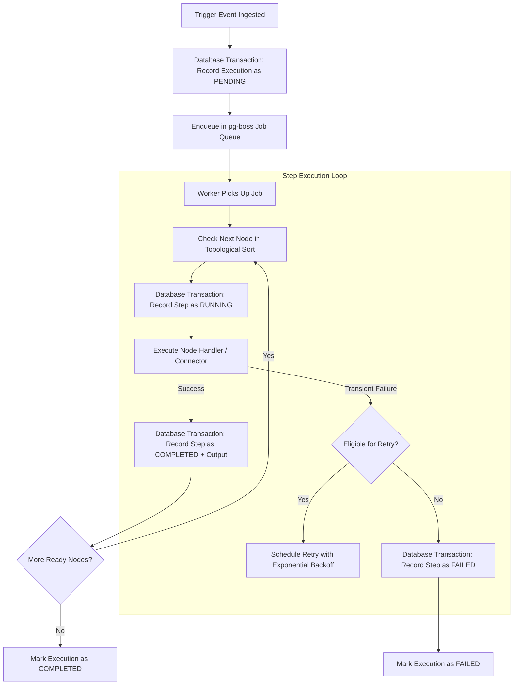

# Reliability, Fault Tolerance & Execution Guarantees

## 1. Durable Execution Architecture

A central differentiator between an ad-hoc script runner and an enterprise automation platform is **durable execution**. If an application process crashes or reboots in the middle of a 10-step workflow, the platform must not lose track of progress, corrupt state, or blindly re-execute non-idempotent operations.



---

## 2. Delivery & Processing Semantics

- **At-Least-Once Trigger Processing**: Triggers are persisted immediately upon receipt before acknowledging the external caller.
- **Idempotency Keys**:
  - Triggers accept an optional `Idempotency-Key` HTTP header. Duplicate requests within a 24-hour window return the existing execution ID without creating duplicate executions.
  - Connector operations explicitly declare whether they are idempotent (`isIdempotent: true`).
- **Side-Effect Guarantees**: For non-idempotent actions (such as sending an email or charging a payment), the engine will not blindly retry if a socket timeout occurs after the packet was transmitted. These cases transition to `FAILED` with a descriptive error code (`UNCERTAIN_TIMEOUT`), allowing operator intervention or an explicit compensation node.

---

## 3. Retry Policies & Exponential Backoff

Nodes can be configured with an explicit `retryPolicy`:

```typescript
export interface RetryPolicy {
  maxRetries: number;       // e.g. 3 retries
  initialIntervalMs: number;// e.g. 1000 ms
  backoffMultiplier: number;// e.g. 2.0
  maxIntervalMs: number;    // e.g. 30,000 ms
  jitter: boolean;          // Randomizes delay by +/- 20% to prevent thundering herd
  retryableErrorCodes: string[]; // e.g. ["ECONNRESET", "ETIMEDOUT", "HTTP_502", "HTTP_503", "HTTP_504"]
}
```

### Error Classification
- **Retryable Errors**: Network drops (`ECONNREFUSED`, `ETIMEDOUT`), HTTP 429 (Rate Limited), HTTP 500/502/503/504 (Server Errors).
- **Non-Retryable Errors**: HTTP 400 (Bad Request), HTTP 401/403 (Unauthorized / Forbidden), Zod schema validation errors, expression syntax errors. Non-retryable errors immediately fail the node.

---

## 4. PostgreSQL Job Processing via `pg-boss`

Rather than operating a separate Redis or RabbitMQ cluster, NEXORA leverages `pg-boss`:
- **Transactional Enqueueing**: Jobs are enqueued within the same PostgreSQL transaction that saves the initial execution record. This guarantees zero orphaned executions.
- **Worker Heartbeats**: Workers emit periodic heartbeats. If a node process dies abruptly, `pg-boss` detects the expired lock and re-dispatches the job to a healthy worker.
- **Concurrency & Rate Limits**: Configurable concurrency pools per organization to prevent noisy-neighbor starvation.

---

## 5. Crash Recovery & Resumption

When a worker node boots up:
1. It queries for stale executions marked `RUNNING` whose heartbeat has lapsed.
2. It inspects the completed `StepExecutions` in the database.
3. Because completed steps already have their inputs and outputs durably saved, execution resumes at the first uncompleted or interrupted node rather than starting from node 0.
4. Nodes marked `WAITING` (such as human approval gates or time delays) remain safely parked in PostgreSQL without consuming active worker threads or RAM.

---

## 6. Execution Cancellation

Authorized operators can issue a cancellation command (`POST /api/v1/executions/:id/cancel`):
- Updates execution status to `CANCELLED`.
- Signals active workers via cooperative cancellation tokens.
- Halts subsequent DAG node traversal immediately.
- Records audit log entry with operator details and reason.
