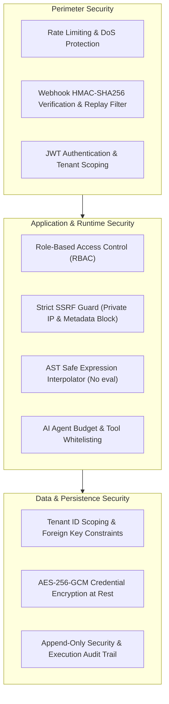

# Security Architecture & Threat Mitigation

## 1. Threat Model & Defense-in-Depth

The NEXORA Automation Platform executes user-defined logic, interacts with external network APIs, stores confidential integration credentials, and makes AI-driven business decisions. Consequently, security is architected into every layer.

---

## 2. Multi-Tenancy & Data Isolation

1. **Mandatory Tenant Scoping**: Every database entity (`workflows`, `workflow_versions`, `executions`, `credentials`, `approvals`, `audit_logs`) has a mandatory `organizationId` foreign key.
2. **Context-Derived Queries**: Tenant ID is extracted strictly from the verified JWT / session context. Tenant ID passed in request bodies is never trusted.
3. **Cross-Tenant Attack Prevention**: Automated security tests explicitly verify that Organization A cannot view, execute, edit, or delete workflows or credentials belonging to Organization B.

---

## 3. Role-Based Access Control (RBAC)

The platform defines 5 distinct organizational roles:

| Role | Workflows (Read/Write) | Execute Workflows | Manage Credentials | Approve Requests | View Audit Logs | Manage Org Users |
| :--- | :---: | :---: | :---: | :---: | :---: | :---: |
| **Org Admin** | Read / Write | Yes | Read / Write | Yes | Yes | Yes |
| **Workflow Editor** | Read / Write | Yes | View Metadata | No | Read-only | No |
| **Workflow Operator**| Read-only | Yes | None | No | Read-only | No |
| **Approver** | Read-only | No | None | Yes | Read-only | No |
| **Viewer** | Read-only | No | None | No | Read-only | No |

---

## 4. Server-Side Request Forgery (SSRF) Protection

When executing outgoing HTTP requests (via `action:http` or webhook notifications), users can configure target URLs. To prevent malicious actors from attacking internal networks or cloud metadata APIs, the engine enforces strict SSRF checks:

1. **Protocol Restriction**: Only `http:` and `https:` schemes are accepted. `file:`, `ftp:`, `gopher:`, and custom schemes are rejected.
2. **Pre-flight DNS Resolution**: The engine resolves the destination hostname to its underlying IP addresses before opening sockets.
3. **Blacklisted IP Ranges**:
   - `127.0.0.0/8` and `::1` (Loopback / Localhost)
   - `10.0.0.0/8`, `172.16.0.0/12`, `192.168.0.0/16` (RFC1918 Private Subnets)
   - `169.254.169.254` (AWS, GCP, Azure, DigitalOcean Instance Metadata Service)
   - `fc00::/7` and `fe80::/10` (IPv6 Unique Local and Link-Local)
4. **Redirect Following Guard**: If the target server responds with HTTP 301, 302, 307, or 308, the redirect target URL is recursively validated against the SSRF guard before the subsequent request is issued.

---

## 5. Webhook Security & Replay Defense

Inbound webhook triggers (`trigger:webhook`) implement cryptographic verification:

- **HMAC Signature**: Computes `HMAC-SHA256(payload, webhookSecret)` and verifies it using constant-time string comparison (`crypto.timingSafeEqual`) to prevent timing attacks.
- **Timestamp Tolerance Window**: Requires an `X-Nexora-Timestamp` header within a $\pm 300$ second window from current server time. Requests outside this window are rejected.
- **Replay Protection**: Tracks webhook event IDs / nonces in a short-lived cache to reject duplicate transmissions.

---

## 6. Credential Encryption at Rest (AES-256-GCM)

All customer secrets (API keys, bearer tokens, OAuth client secrets, webhook secrets) are encrypted before writing to PostgreSQL:

- **Algorithm**: `AES-256-GCM` (Galois/Counter Mode) providing authenticated encryption.
- **Initialization Vector (IV)**: A cryptographically random 12-byte IV is generated per encryption operation.
- **Authentication Tag**: A 16-byte GCM authentication tag verifies ciphertext integrity and authenticity.
- **Key Derivation**: The 256-bit encryption key is loaded from the environment (`ENCRYPTION_MASTER_KEY`). No hardcoded keys exist in source code.
- **Storage Format**: `iv:authTag:ciphertext` encoded in base64.
- **API Redaction**: Secret values are never returned over HTTP endpoints. Only metadata (`id`, `name`, `type`, `maskedHint`, `createdAt`) is exposed.

---

## 7. Safe Expression Interpolation

To eliminate Remote Code Execution (RCE) vulnerabilities:
- The expression engine avoids `eval()`, `new Function()`, and JavaScript runtime interpreters.
- Input expressions (`{{ nodes.lookup.output.email }}`) are parsed with a dedicated tokenizer that resolves strictly defined variable paths using safe object property accessors.
