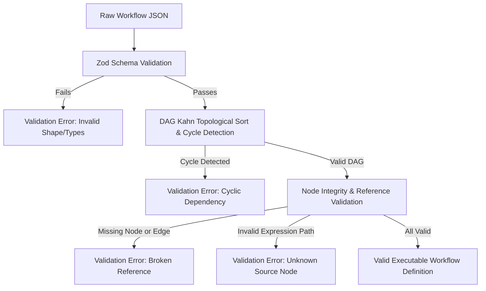
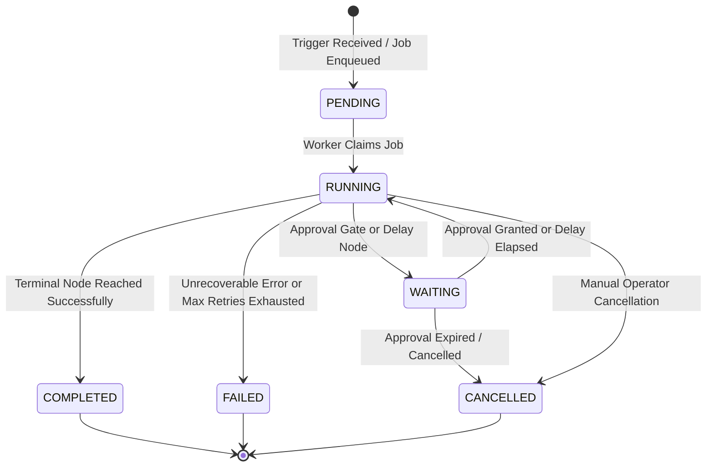

# Workflow Engine Specification & Execution Lifecycle

## 1. Directed Acyclic Graph (DAG) Model

Workflows in the NEXORA platform are represented as a Directed Acyclic Graph (DAG) $G = (V, E)$, where:
- $V = \{n_1, n_2, \dots, n_k\}$ is the set of **Nodes** (triggers, actions, decisions, transformations).
- $E \subseteq V \times V$ is the set of **Edges** (directed dependencies and data conduits).

### Core Schema Structure

```json
{
  "$schema": "https://json-schema.org/draft/2020-12/schema",
  "id": "wf_sales_qualification",
  "name": "Enterprise Lead Qualification & Routing",
  "description": "Ingests inbound leads, classifies intent via AI, checks CRM, requests manager approval for high value, and sends email notification.",
  "version": 1,
  "trigger": {
    "nodeId": "node_webhook_trigger",
    "type": "trigger:webhook"
  },
  "nodes": [
    {
      "id": "node_webhook_trigger",
      "type": "trigger:webhook",
      "name": "Inbound Lead Webhook",
      "config": {
        "webhookPath": "/leads/inbound",
        "requireSignature": true
      }
    },
    {
      "id": "node_transform_lead",
      "type": "action:transform",
      "name": "Normalize Lead Payload",
      "config": {
        "mappings": {
          "email": "{{ nodes.node_webhook_trigger.output.email | lower }}",
          "company": "{{ nodes.node_webhook_trigger.output.company }}",
          "estimatedValue": "{{ nodes.node_webhook_trigger.output.budget | default: 0 }}"
        }
      }
    }
  ],
  "edges": [
    {
      "id": "edge_1",
      "source": "node_webhook_trigger",
      "target": "node_transform_lead",
      "sourceHandle": "default",
      "targetHandle": "default"
    }
  ]
}
```

---

## 2. Supported Node Types (14 Standard Types)

Each node is governed by a typed schema implementing `NodeDefinition<TConfig, TInput, TOutput>`.

| # | Node Type Identifier | Category | Description | Primary Config Properties |
| :--- | :--- | :--- | :--- | :--- |
| 1 | `trigger:manual` | Trigger | Triggered manually by authenticated operator via UI/API. | `inputSchema` (JSON schema for form generation) |
| 2 | `trigger:webhook` | Trigger | Ingests external HTTP requests with signature verification. | `webhookPath`, `secretCredentialId`, `signatureHeader` |
| 3 | `trigger:schedule` | Trigger | Cron or interval based scheduled invocation. | `cronExpression`, `timezone`, `misfirePolicy` |
| 4 | `action:http` | Action | Executes an outbound REST HTTP request with SSRF defense. | `method`, `url`, `headers`, `body`, `timeoutMs`, `credentialId` |
| 5 | `action:transform` | Action | Evaluates safe template expressions and field mappings. | `mappings` (dictionary of field targets and expressions) |
| 6 | `action:condition` | Flow Control | Evaluates boolean expression and branches to `true` or `false` edge. | `conditions` (left operand, operator, right operand) |
| 7 | `action:delay` | Flow Control | Suspends execution state for specified duration. | `durationSeconds`, `untilTimestamp` |
| 8 | `action:ai:classify` | AI | Classifies input text into a predefined set of categories. | `prompt`, `categories`, `confidenceThreshold`, `modelProvider` |
| 9 | `action:ai:extract` | AI | Extracts structured JSON conforming to a target schema. | `prompt`, `jsonSchema`, `temperature`, `modelProvider` |
| 10 | `action:agent:tool` | AI Agent | Executes a bounded autonomous agent loop with permitted tools. | `goal`, `systemPrompt`, `allowedTools`, `maxIterations`, `maxToolCalls` |
| 11 | `action:approval` | Human-in-Loop | Pauses workflow execution until authorized user approves/rejects. | `title`, `description`, `approverRole`, `timeoutSeconds`, `payload` |
| 12 | `action:email` | Integration | Sends an email via configured provider or deterministic mock. | `to`, `subject`, `bodyHtml`, `templateId`, `credentialId` |
| 13 | `action:crm` | Integration | Performs CRUD on CRM Contacts, Leads, Notes, or Activities. | `operation` (`createLead`, `findContact`, `updateLead`), `params` |
| 14 | `action:completion` | Flow Control | Marks terminal workflow boundary with explicit execution status. | `finalStatus` (`SUCCESS`, `REJECTED`, `ABORTED`), `outputSummary` |

---

## 3. Workflow Graph Validation

Before a workflow can be saved or executed, it passes through a multi-pass validation pipeline:



### Kahn's Algorithm for Topological Sort & Cycle Detection

1. Compute in-degree (number of incoming edges) for every node in $V$.
2. Enqueue all nodes with in-degree 0 (triggers).
3. While queue is not empty:
   - Dequeue node $u$, append $u$ to sorted list $L$.
   - For each outgoing edge $(u, v) \in E$:
     - Decrement in-degree of $v$.
     - If in-degree of $v == 0$, enqueue $v$.
4. If length of $L \neq |V|$, a **Cycle exists**. Workflow validation fails with the list of participating cycle nodes.
5. Identify **Unreachable Nodes**: Any action node not reachable from the trigger node is flagged as a warning or rejected based on strict mode.

---

## 4. Execution State Machine & Lifecycle

Every workflow execution transitions through a well-defined set of states:



### State Definitions

- **`PENDING`**: Trigger has been received and validated. The execution row is inserted into PostgreSQL, and a job is queued in `pg-boss`.
- **`RUNNING`**: Worker has picked up the job and is traversing the DAG executing ready nodes.
- **`WAITING`**: Execution is safely suspended in durable storage. The current node is waiting for an external event (e.g. human approval decision or timer expiration). No active worker process holds memory locks.
- **`COMPLETED`**: All reachable nodes on active branches finished with `SUCCESS`.
- **`FAILED`**: A node encountered a fatal error, or its retry policy was exhausted without an error-handling branch.
- **`CANCELLED`**: An authorized operator cancelled the execution, or an approval timed out with default cancellation policy.

---

## 5. Safe Expression Language & Data Mapping

Data flows between nodes using safe token interpolation. 

### Interpolation Syntax
- Direct variable access: `{{ nodes.<nodeId>.output.<property> }}`
- Trigger payload: `{{ trigger.body.<property> }}`
- Execution metadata: `{{ execution.id }}`, `{{ execution.organizationId }}`

### Security & Safety Rules
1. **No Code Execution**: Arbitrary JavaScript (`eval`, `new Function`, `Function`, `setTimeout`, or script injection) is strictly forbidden and structurally impossible in the parser.
2. **Safe Property Path Traversal**: Expressions are tokenized using a deterministic regex and evaluated against an immutable context object using safe lodash-like path resolution (`get(context, path)`).
3. **Missing Property Handling**: Missing references resolve to `undefined` or a configurable fallback, preventing unhandled engine crashes.
4. **Pre-flight Static Reference Check**: During workflow validation, every expression `nodes.X.output.Y` is checked to ensure node `X` is an ancestor of the current node in the DAG.
